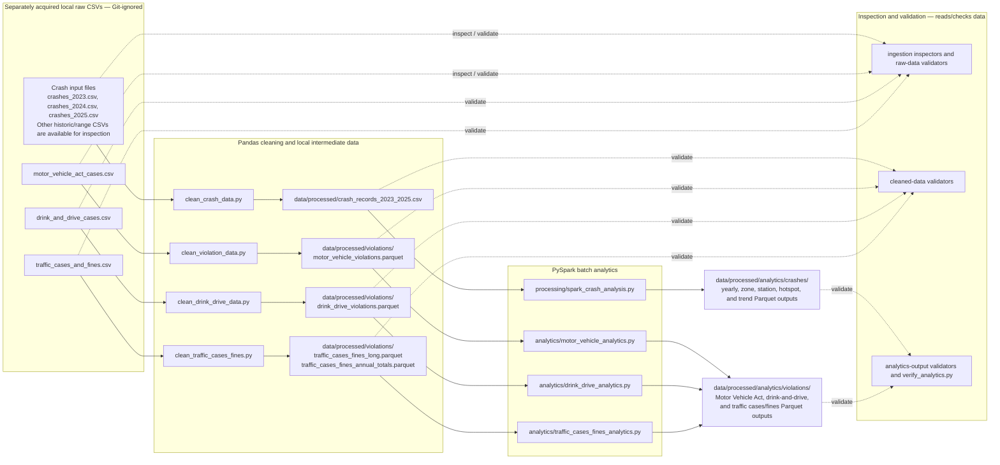
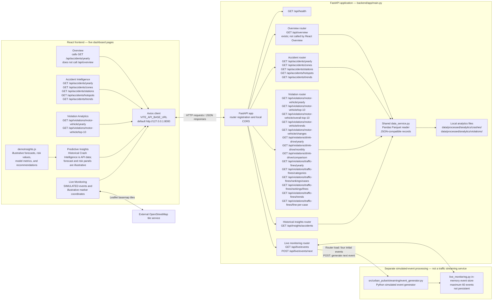

# URBAN PULSE System Architecture

This document describes the implemented URBAN PULSE data pipeline and application runtime. It separates batch processing of historical datasets from the simulated Live Monitoring event path.

## 1. Batch Historical Data Pipeline

Raw CSV files are local inputs that must be acquired separately; they are not generated by the project scripts and are excluded from Git. Cleaning and analytics create the intermediate, cleaned, and analytical outputs on the local filesystem.

### Pipeline details

- The current crash cleaner reads the 2023, 2024, and 2025 station CSV files, combines them into `data/processed/crash_records_2023_2025.csv`, and the Spark crash analysis script reads that intermediate file. Other historical/range crash CSVs are available to inspection scripts; this diagram does not imply they all feed the current crash analytics job.
- The Motor Vehicle Act, Drink and Drive, and Traffic Cases and Fines inputs each follow their own cleaner and analytics module. Traffic Cases and Fines preserves a separate annual-totals output containing the source-reported annual totals.
- The analytics outputs are saved as Parquet under `data/processed/analytics/crashes/` and `data/processed/analytics/violations/`. Small aggregate outputs use Pandas with PyArrow for Parquet writing.
- Validation and inspection scripts check raw, cleaned, and analytical data. They do not generate or impute source values. Missing values remain missing.
- Relevant checks include `inspect_datasets.py`, `inspect_crash_data.py`, `validate_crash_data.py`, `validate_combined_data.py`, `validate_violation_data.py`, `validate_drink_drive_data.py`, `validate_traffic_cases_fines.py`, the analytics validation scripts, and `verify_analytics.py`.
- `data/raw/` and `data/processed/` are excluded by `.gitignore`; no database or remote data lake is used by this pipeline.

## 2. Application and Simulated-Event Runtime

The browser uses Axios to call FastAPI. Historical analytics routes read local Parquet outputs through the shared Pandas data service. Live Monitoring is an independent simulation path: the backend event generator creates events, and the router keeps them in a bounded in-memory store.

### Runtime details and boundaries

- The React Overview page requests only `GET /api/accidents/yearly` for its historical accident chart. The FastAPI backend also exposes `GET /api/overview`, but the current React Overview page does not call it.
- Accident Intelligence calls the five accident endpoints shown above. Violation Analytics currently calls `GET /api/violations/motor-vehicle/yearly` and `GET /api/violations/motor-vehicle/top-10`; its area comparison remains illustrative. The backend exposes additional violation endpoints listed in the README API reference.
- Predictive Insights calls `GET /api/insights/accidents` for historical crash hotspots, positive station changes, and fatality severity from 2023–2025. These are historical summaries, not forecasts. The forecast, risk scores, model metrics, and recommendations come from illustrative frontend content; no trained ML model is connected.
- Live Monitoring initially requests `GET /api/live/events` and requests a next simulated event with `POST /api/live/events/next` while running (the frontend interval is 4.5 seconds). The event generator uses simulated categories, locations, severities, and illustrative Bengaluru coordinates. The event store is capped at 60, exists only in backend memory, and is lost when the process stops.
- OpenStreetMap supplies the map basemap tiles. It does not supply the event data or marker coordinates; those remain simulated.
- The implementation has no Kafka or Spark Structured Streaming service, persistent database, weather API, real traffic-sensor integration, or connected predictive model. Historical outputs are local files, not a database or cloud storage service.
