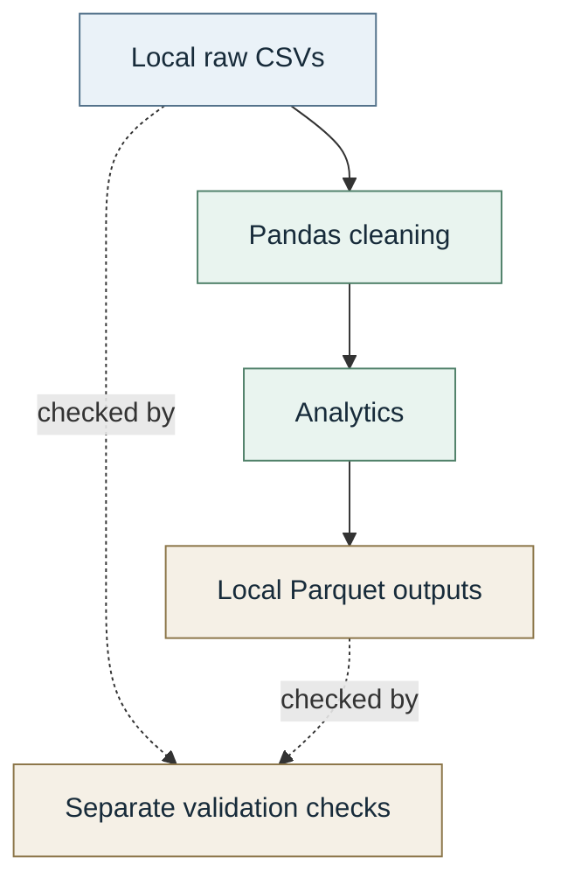
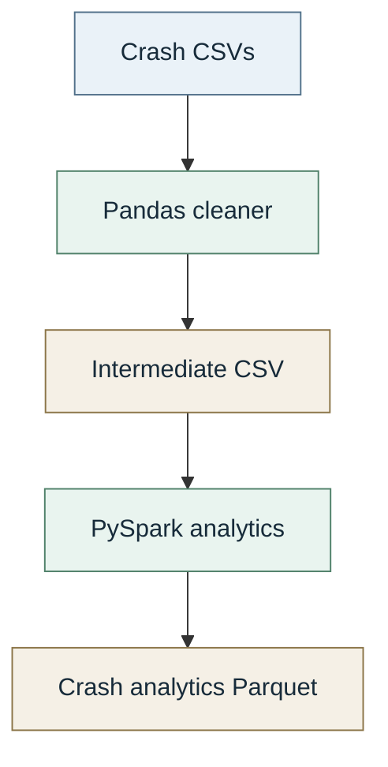
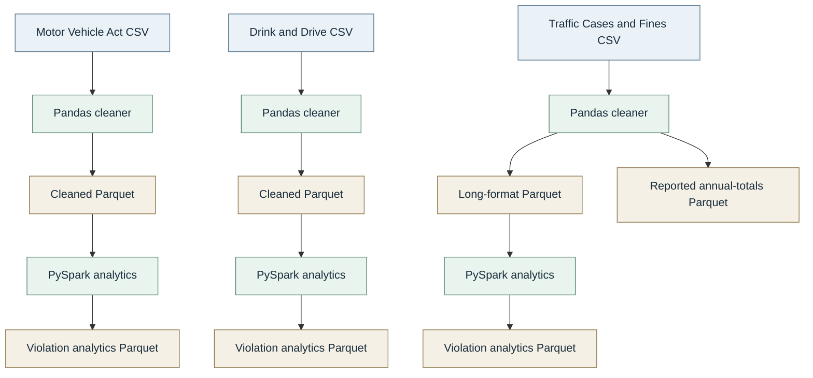
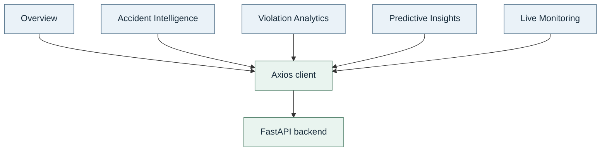
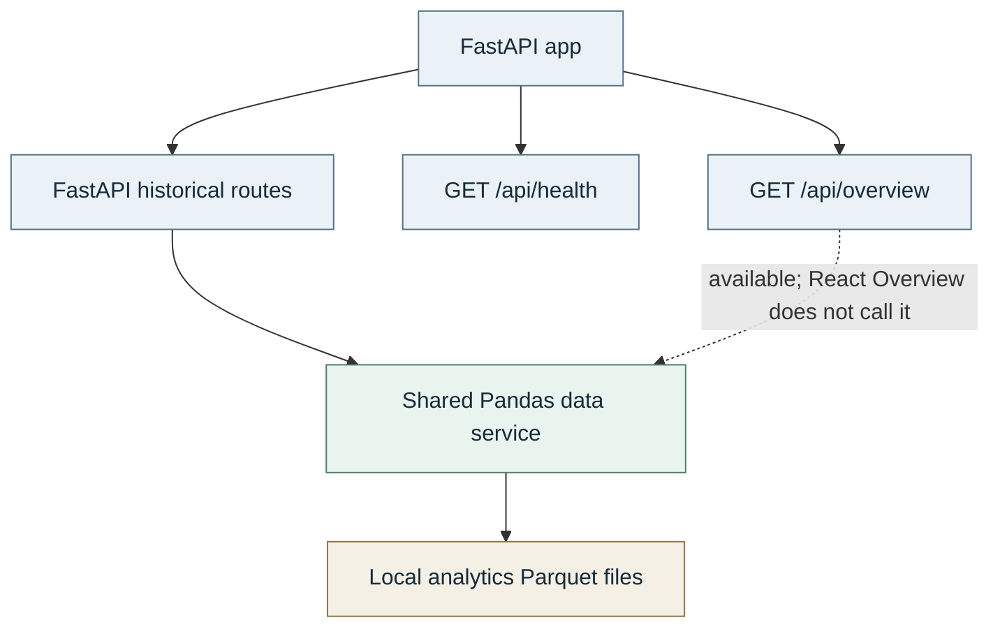
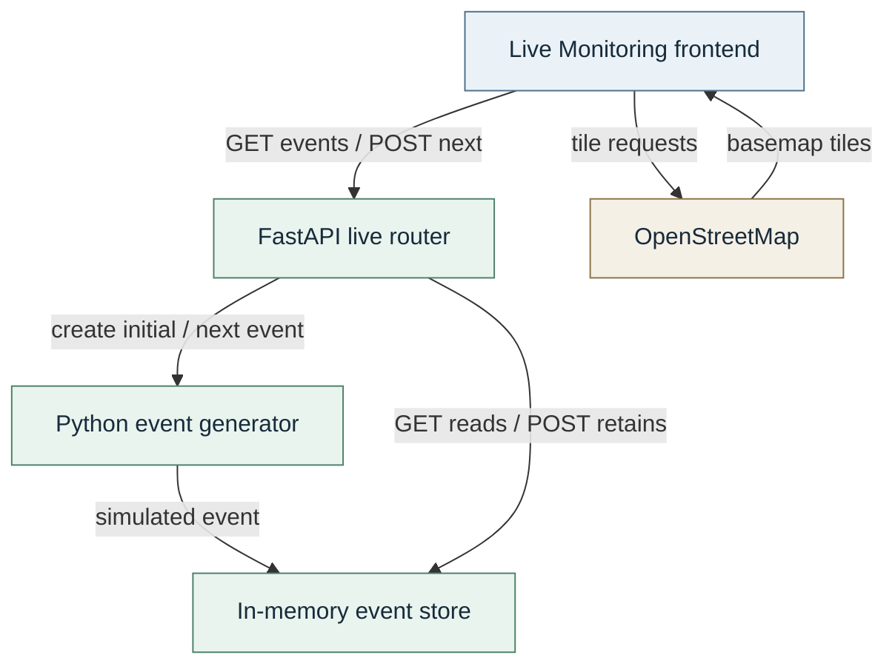

# URBAN PULSE System Architecture

This document describes the implemented URBAN PULSE data pipeline and application runtime. It separates batch processing of historical datasets from the simulated Live Monitoring event path.

## 1. Historical Data Pipeline

Raw CSV files are local inputs acquired separately; project scripts do not generate them, and Git ignores them. Cleaning and analytics write intermediate and analytical files locally.

### 1.1 Pipeline overview

`data/raw/` and `data/processed/` are Git-ignored. Validation and inspection read/check data; they do not create or impute source values. Missing values remain missing. There is no database or remote data lake in this pipeline.

### 1.2 Crash data processing

`clean_crash_data.py` reads `data/raw/road_crashes/crashes_2023.csv`, `crashes_2024.csv`, and `crashes_2025.csv`, then combines station records into `data/processed/crash_records_2023_2025.csv`. `processing/spark_crash_analysis.py` reads that CSV and writes Parquet under `data/processed/analytics/crashes/`, including yearly, zone, station, hotspot, and trend outputs. Other historical/range crash CSVs are available to inspection scripts; they are not implied as inputs to this current analytics job. Small aggregate outputs use Pandas with PyArrow for Parquet writing.

### 1.3 Violation data processing

- Motor Vehicle Act: `data/raw/motor_vehicle_act_cases.csv` ? `processing/clean_violation_data.py` ? `data/processed/violations/motor_vehicle_violations.parquet` ? `analytics/motor_vehicle_analytics.py`.
- Drink and Drive: `data/raw/drink_and_drive_cases.csv` ? `processing/clean_drink_drive_data.py` ? `data/processed/violations/drink_drive_violations.parquet` ? `analytics/drink_drive_analytics.py`.
- Traffic Cases and Fines: `data/raw/traffic_cases_and_fines.csv` ? `processing/clean_traffic_cases_fines.py` ? `data/processed/violations/traffic_cases_fines_long.parquet` and `traffic_cases_fines_annual_totals.parquet`. `analytics/traffic_cases_fines_analytics.py` reads the long-format file; the annual-totals file preserves source-reported totals separately.
- Each analytics script writes Parquet beneath `data/processed/analytics/violations/`. Missing values remain missing.

### Pipeline validation and inspection

Relevant checks include `inspect_datasets.py`, `inspect_crash_data.py`, `validate_crash_data.py`, `validate_combined_data.py`, `validate_violation_data.py`, `validate_drink_drive_data.py`, `validate_traffic_cases_fines.py`, analytics validation scripts, and `verify_analytics.py`. These inspect or validate raw, cleaned, and analytical data; they do not generate or impute source values.

## 2. Application Runtime

The browser uses Axios to call FastAPI. Historical analytics routes read local Parquet files through a shared Pandas data service. Live Monitoring is a separate simulation path: the backend event generator creates events, and its router keeps them in a bounded in-memory store.

### 2.1 Frontend-to-API communication

Actual page calls are:

- **Overview:** `GET /api/accidents/yearly`. The backend also exposes `GET /api/overview`, but React Overview does not call it.
- **Accident Intelligence:** `GET /api/accidents/yearly`, `GET /api/accidents/zones`, `GET /api/accidents/stations`, `GET /api/accidents/hotspots`, and `GET /api/accidents/trends`.
- **Violation Analytics:** `GET /api/violations/motor-vehicle/yearly` and `/api/violations/motor-vehicle/top-10`. Area comparison remains illustrative.
- **Predictive Insights:** `GET /api/insights/accidents` supplies historical hotspots, positive station changes, and fatality severity for 2023–2025. Forecasts, risk scores, model metrics, and recommendations are illustrative; no trained model is connected.
- **Live Monitoring:** `GET /api/live/events` and `POST /api/live/events/next` while running, at a 4.5-second frontend interval. Axios uses `VITE_API_BASE_URL`, defaulting to `http://127.0.0.1:8000`.

### 2.2 Historical backend data flow

`backend/app/main.py` registers the routers and local CORS. Historical route modules are `backend/app/routers/overview.py`, `accidents.py`, `violations.py`, and `insights.py`. Available routes are:

- Overview: `GET /api/overview` (available; unused by React Overview).
- Accidents: `GET /api/accidents/yearly`, `/api/accidents/zones`, `/api/accidents/stations`, `/api/accidents/hotspots`, `/api/accidents/trends`.
- Motor Vehicle Act: `GET /api/violations/motor-vehicle/yearly`, `/api/violations/motor-vehicle/top-10`, `/api/violations/motor-vehicle/overall-top-10`, `/api/violations/motor-vehicle/trends`, `/api/violations/motor-vehicle/changes`.
- Drink and Drive: `GET /api/violations/drink-drive/yearly`, `/api/violations/drink-drive/monthly`, `/api/violations/drink-drive/comparison`.
- Traffic Fines: `GET /api/violations/traffic-fines/yearly`, `/api/violations/traffic-fines/categories`, `/api/violations/traffic-fines/rankings/cases`, `/api/violations/traffic-fines/rankings/fines`, `/api/violations/traffic-fines/trends`, `/api/violations/traffic-fines/fine-per-case`.
- Insights: `GET /api/insights/accidents`. The health endpoint is `GET /api/health`.

`backend/app/services/data_service.py` uses Pandas to read Parquet under `data/processed/analytics/` and converts records to JSON-compatible values (missing values become JSON null). These are local files, not a database or cloud storage service.

### 2.3 Live Monitoring simulation

`frontend/src/components/live/LiveMonitoring.jsx` uses `GET /api/live/events` and `POST /api/live/events/next`. `backend/app/routers/live_monitoring.py` initializes the store with four events; each POST generates and retains one event, and the in-memory store is capped at 60 and lost when the process stops. `src/urban_pulse/streaming/event_generator.py` supplies simulated categories, locations, severities, and illustrative Bengaluru coordinates. These coordinates and events are not real traffic data. OpenStreetMap supplies Leaflet basemap tiles only; it supplies neither event data nor marker coordinates.

The implementation has no Kafka or Spark Structured Streaming service, persistent database, weather API, real traffic-sensor integration, or connected predictive model. Historical analytics outputs are local files.
